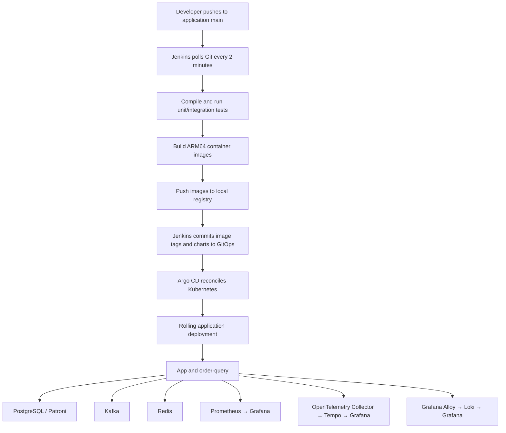
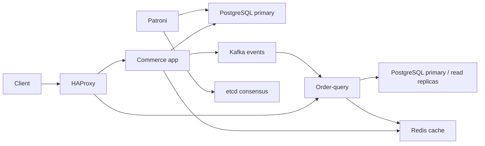

# Local CI/CD flow and configuration

Configuration explained as of 2026-10-27. This document describes the local
development environment; it does not establish production availability or phase
qualification. For setup commands, credentials and operational procedures, see
[the local CI/CD runbook](local-cicd.md).

## Delivery flow



### 1. Commit, compilation and tests

Developers push source to the
[application repository](https://github.com/nghiango/hyper-scale-commerce).
Jenkins polls for changes approximately every two minutes:

```groovy
triggers { pollSCM('H/2 * * * *') }
```

The current setup uses Git polling, without a GitHub webhook or public endpoint.
The [Jenkinsfile](../../Jenkinsfile) defines these stages:

| Stage | Behavior |
|---|---|
| Checkout | Fetch source, capture its full commit SHA, and validate release configuration |
| Build/test | Run `./gradlew clean build --no-daemon`, including unit/integration tests |
| Publish | Build and push ARM64 images for the configured deployment branch |
| GitOps update | Commit chart sources and image references to the GitOps repository |

A failed validation or build stops the pipeline before deployment publication.
Jenkins runs outside Kubernetes in Docker Compose. Builds run on its
`local-arm64` agent, which has access to the local Docker engine. The controller
does not execute builds. The pipeline disables concurrent builds and has a
90-minute timeout. Deployment defaults to application branch `main`.

### 2. ARM64 images and local registry

[publish.sh](../../local-ci/scripts/publish.sh) uses Docker Buildx with
`--platform linux/arm64` to publish:

```text
hyperscale-app:<full-commit-SHA>
hyperscale-order-query:<full-commit-SHA>
hyperscale-patroni:<full-commit-SHA>
```

The registry runs in Kubernetes namespace `local-registry` and uses a 10Gi PVC.

| Address | Purpose |
|---|---|
| `hyperscale-k8s-worker:30500/hyperscale` | Jenkins publishing and Kubernetes image references |
| `localhost:5001` | Registry access from the host machine |

Commit tags identify the application source behind an image. The registry does
not enforce tag immutability. A pod's `localhost` refers to that pod, so images
use the registry address reachable from the kind network.

### 3. Application repository versus GitOps repository

The application repository contains source code, tests, Dockerfiles, chart
templates and the delivery pipeline. The
[GitOps repository](https://github.com/nghiango/hyper-scale-commerce-gitops)
contains the desired deployment:

```text
charts/
  commerce/                  Application and dependency resources
  platform/                  Monitoring and Kafka UI
environments/local/
  values.yaml                Local image tags and overrides
```

[gitops.sh](../../local-ci/scripts/gitops.sh) clones GitOps and calls
[release.py](../../local-ci/scripts/release.py). The generator copies charts from
the tested application checkout and inserts the registry prefix and full commit
SHA into the local values file. Jenkins then commits and pushes the release.

Jenkins authenticates using its write deploy key (`gitops-write` credential).
Argo CD uses a separate read deploy key. The host SSH alias `personal.github.com`
is local configuration; Jenkins and Argo use the canonical `github.com` URL.
Private keys belong in credentials/Secrets and must never be committed.

**Future Jenkins releases replace the GitOps chart copies.** Durable changes
must also be made in the application repository's chart templates and release
seed, rather than only editing the generated GitOps repository.

### 4. Argo CD reconciliation

[applications.yaml](../../local-ci/gitops/applications.yaml) defines:

| Argo Application | Resources |
|---|---|
| `hyperscale-local` | App, order-query, Kafka, PostgreSQL, etcd, Redis, ingress and backups |
| `hyperscale-local-platform` | Prometheus, Grafana, Collector, Tempo and Kafka UI |

Both watch GitOps `main` and deploy into namespace `hyperscale`, on the local
`kind-hyperscale-k8s` cluster. Argo renders Helm charts with the configured values
and applies the resulting Kubernetes resources.

Automatic sync deploys Git changes. `selfHeal: true` corrects live configuration
drift. Automatic pruning is disabled: removing a resource from Git does not
automatically delete the live resource.

Argo ignores `/spec/replicas` for app and order-query and uses
`RespectIgnoreDifferences=true`, allowing the HPA to control their replica counts.

### 5. Rolling deployment and probes

App and order-query use:

```yaml
strategy:
  type: RollingUpdate
  rollingUpdate:
    maxUnavailable: 0
    maxSurge: 1
```

Kubernetes can create one additional pod, wait for readiness, and then remove an
old pod. This reduces interruption when capacity and dependencies are available;
it does not guarantee zero downtime for every failure.

Startup and liveness probes use `/actuator/health/liveness`. Readiness uses
`/actuator/health/readiness` and deliberately remains independent of database
health. Aggregate `/actuator/health` reports dependency failures separately.

## Runtime request and dependency flow



| Dependency | Role |
|---|---|
| PostgreSQL | Persistent source of truth; Patroni manages primary and standby roles |
| etcd | Three-member coordination store used by Patroni |
| Kafka | Business events and asynchronous processing; three brokers/controllers |
| Redis | Shared cache; one local instance |
| HAProxy | Routes client requests to application services |

Pods connect through Kubernetes service DNS, including
`kafka-headless.hyperscale.svc.cluster.local:9092` and
`redis.hyperscale.svc.cluster.local:6379`, rather than host browser ports.
Database connections distinguish primary and read-replica targets. The local
profile limits each service instance to an eight-connection primary pool and a
four-connection replica pool.

RabbitMQ is excluded from this configuration.

## Replicas, autoscaling and resource limits

The local release overrides are defined in
[the release values seed](../../local-ci/gitops/environments/local/values.yaml).
Baseline performance defaults remain in
[the commerce chart values](../../performance/helm/hyperscale-commerce/values.yaml).

| Component | Local replica policy |
|---|---|
| App | HPA: 1–3 |
| Order-query | HPA: 1–3 |
| Kafka | 3 |
| etcd | 3 |
| PostgreSQL/Patroni | 3 |
| Redis, ingress, monitoring and Kafka UI | 1 each |

App/query HPA targets 70% CPU utilization relative to requested CPU. Local
memory-based autoscaling is disabled because normal JVM resident memory was
keeping replicas at three. Baseline performance HPAs retain both CPU and memory
metrics. HPA stabilization means scaling down is not instantaneous.

Each app/query pod requests 500m CPU and 512Mi memory, with limits of 2 CPU and
1Gi memory. Requests guide scheduling and CPU utilization calculation; limits
bound resource consumption. CPU limits can cause throttling, while exceeding a
memory limit can cause an OOM termination.

Local app/query/ingress/Redis PDBs allow zero available pods during voluntary
maintenance. Quorum PDBs retain a minimum of two. PDBs govern voluntary eviction;
they do not prevent direct workload scale-down or create missing replicas.
Singleton services can therefore experience maintenance downtime.

Kafka and etcd membership must not be reduced by changing StatefulSet replicas
alone. Kafka's persisted voter set must match its quorum configuration. Preserve
PVCs when recovering accidental scale-downs; do not clear state to suppress a
membership error. PostgreSQL read pools require available standby instances.

## Metrics, traces and operator tools

| Signal | Flow |
|---|---|
| Metrics | Prometheus scrapes application `/actuator/prometheus` and Redis exporter every 15 seconds |
| Traces | Applications export Zipkin spans to OpenTelemetry Collector, which forwards OTLP to Tempo |
| Logs | Alloy reads namespace pod logs through Kubernetes API and sends them to persistent Loki storage |
| Visualization | Grafana queries Prometheus, Tempo and Loki |

The Collector accepts Zipkin and OTLP inputs, applies memory limiting and
batching, and exports to Tempo. Prometheus and Tempo have 24-hour retention
settings. Retention configuration alone does not guarantee data survives pod
replacement. Platform configuration is in
[local-ci/platform](../../local-ci/platform).

| Tool | Local address |
|---|---|
| Jenkins | <http://localhost:8090> |
| Argo CD | <https://localhost:8443> |
| Grafana | <http://localhost:3000> |
| Prometheus | <http://localhost:9090> |
| Kafka UI | <http://localhost:8082> |

Kubernetes UI addresses require the corresponding port-forward process to remain
running. Kafka UI is configured read-only. k9s is a terminal client using the
local kubeconfig:

```bash
k9s --context kind-hyperscale-k8s --namespace hyperscale --readonly
```

## Backups and delayed PVC binding

`postgres-backup-daily` is scheduled at `0 2 * * *`. The manifest does not set
`.spec.timeZone`, so scheduling follows the controller's timezone.

Despite the `pgbackrest-repo-pvc` name, the current job runs **`pg_basebackup`**
and writes timestamped archives into the mounted PVC. This does not demonstrate
a complete pgBackRest, WAL-archiving or point-in-time recovery workflow. Backup
and restore success must be verified separately from pod readiness.

The `standard` storage class uses `WaitForFirstConsumer`. The backup PVC remains
Pending until a backup pod that mounts it is scheduled, allowing the provisioner
to select storage on the appropriate node. This message alone is not a storage
failure.

To trigger a backup without waiting for the schedule:

```bash
kubectl --context kind-hyperscale-k8s -n hyperscale \
  create job --from=cronjob/postgres-backup-daily \
  postgres-backup-manual-$(date +%s)
```

Check the resulting Job and logs. PVC binding by itself does not prove a usable
backup was produced.

## Rollback

Revert the appropriate GitOps release commit and push the revert. Argo reconciles
the previous image references and desired configuration. Avoid resetting shared
Git history.

Image rollback does not undo database schema migrations or data changes. Verify
schema compatibility, image availability in the registry and any required data
recovery procedure separately.
